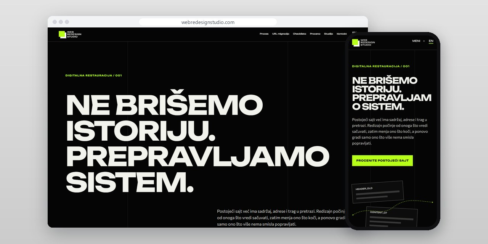
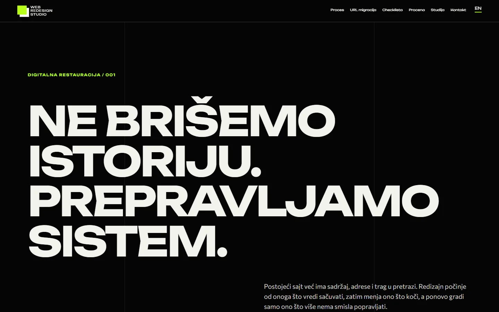
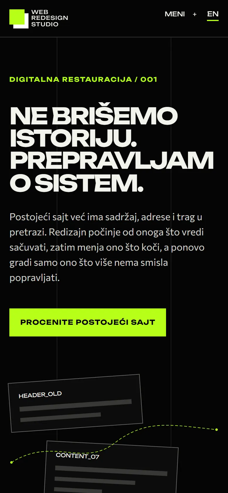

# Web Redesign Studio

A redesign studio site built around one order of work: list the old URLs and content first, then design, then check the move.

**[webredesignstudio.com](https://webredesignstudio.com/)** · [Case study (in Serbian)](https://svilenkovic.rs/radovi/web-redesign-studio) · [Srpski](README.sr.md)

> [!NOTE]
> My own project, not client work. The source code is private. This page describes what the site does and how it is built.

<table>
  <tr><td><b>Client</b></td><td>Own project</td></tr>
  <tr><td><b>Industry</b></td><td>Complete website redesign</td></tr>
  <tr><td><b>Location</b></td><td>Serbia</td></tr>
  <tr><td><b>Type</b></td><td>Multi-page website</td></tr>
  <tr><td><b>My role</b></td><td>Research, design, development, SEO and hosting</td></tr>
  <tr><td><b>Stack</b></td><td>Astro 7, TypeScript, PHP 8.3, SQLite, nginx</td></tr>
</table>

## About the project

A full redesign means more than a new home page laid over the old structure. Before drawing anything I need to know which addresses already exist, what visitors look for, what can be kept and what has to be checked after launch. Web Redesign Studio is built around that order.

The opening scene takes an old interface apart and puts it back together: what carries meaning stays, what gets in the way changes. The redesign checklist covers content, features, old URLs, redirects, forms and phone layouts, and a separate page deals with URL migration, because a good-looking new site does not help if old links lead nowhere. The site publishes no growth percentages or rankings that were never measured.

## What I built

- A redesign checklist and a separate guide to URL migration
- A page for estimating a redesign and a step-by-step process
- A reconstruction scene in black and white with a green signal
- A case study of the 3D Art Kragujevac gallery and service pages
- Launch checks for responses, metadata, assets and protected paths

## Results

| | Performance | Accessibility | Best practices | SEO |
| :-- | :-: | :-: | :-: | :-: |
| Mobile | 100 | 100 | 100 | 100 |
| Desktop | 100 | 100 | 100 | 100 |

PageSpeed Insights, lab test of the live site, October 2026. Security headers: 6 of 6. axe accessibility check: no violations. Structured data: `Organization`, `Person`.

## Screenshots

<table>
  <tr>
    <td width="68%" valign="top"></td>
    <td width="32%" valign="top"></td>
  </tr>
</table>

Redesign checklist on the live site

---

Built by [D. Svilenković](https://svilenkovic.com).
